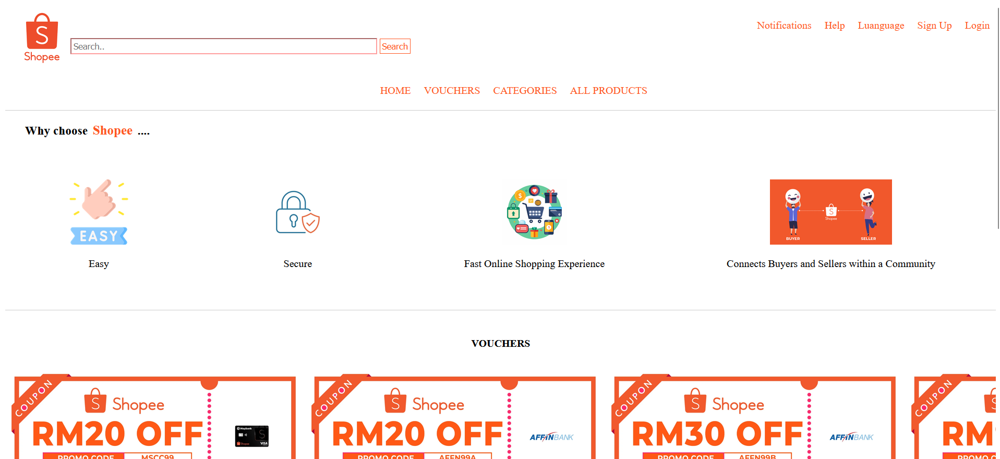
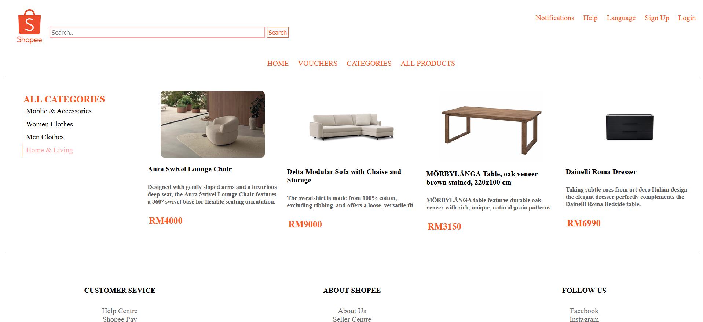
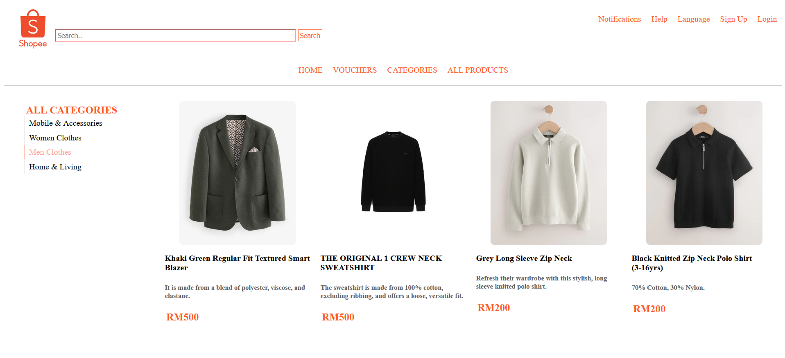
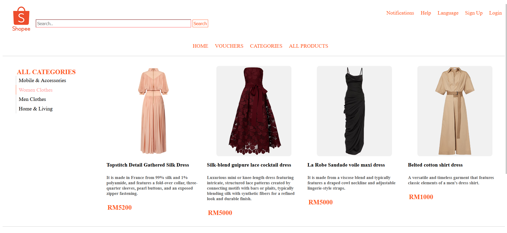
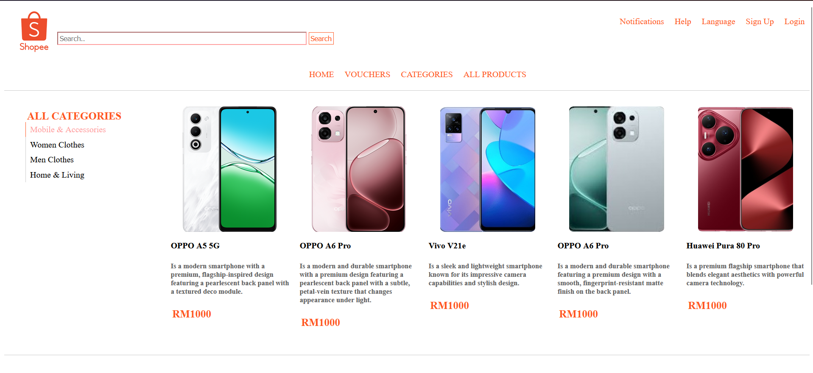

# Web Design Projects

This repository contains website development projects completed during my Diploma in Computer Science studies at New Era University College.

## Project 1: Shopee Website Redesign

A static e-commerce website redesign inspired by Shopee, developed using HTML and CSS.

### Technologies Used
- HTML
- CSS

### Features
- Home page
- Home & Living page
- Men's Clothes page
- Women's Clothes page
- Mobile page
- Product and promotional images
- Navigation between category pages

### Project Structure
```text
Shopee/
├── home.html
├── home&living.html
├── menClothes.html
├── womenClothes.html
├── mobile.html
├── mystyle.css
├── image/
└── screenshots/
    ├── home.png
    ├── home_and_living.png
    ├── men_clothes.png
    ├── mobile.png
    └── women_clothes.png
```

### Screenshots

#### Home Page


#### Home & Living


#### Men's Clothes


#### Women's Clothes


#### Mobile


---

## Project 2: TechVantage Solutions

A responsive digital consulting company website developed as a group project by three students using HTML, CSS and a small amount of JavaScript.

### Technologies Used
- HTML
- CSS
- JavaScript

### Features
- Home page
- Services page
- About Us page
- Contact Us page
- Portfolio page
- Responsive navigation bar
- Mobile hamburger menu
- Mobile-friendly website layout

### Responsive Design
- CSS Media Queries
- Flexbox
- CSS Grid
- Responsive layouts for desktop, tablet and mobile devices
